<div align="center">

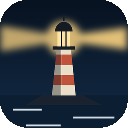

# Keeper

### Thoughts are ships. You keep the lighthouse.

*Each recurring, intrusive thought becomes a named ship. You log it, light it and watch it sail past, or anchor it until the evening watch. Forecasts are checked against what actually happened, ships whose forecasts keep coming to nothing fade into ghosts, and ships that stop coming end up in bottles on the shelf. Free, no ads, no account, no internet permission.*

[](https://github.com/bigdevwhale/keeper/actions/workflows/android.yml)
[](https://github.com/bigdevwhale/keeper/releases/latest)


[](LICENSE)

**English** · [Русский](README.ru.md) · [Changelog](CHANGELOG.md)

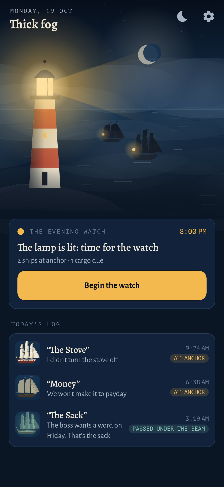 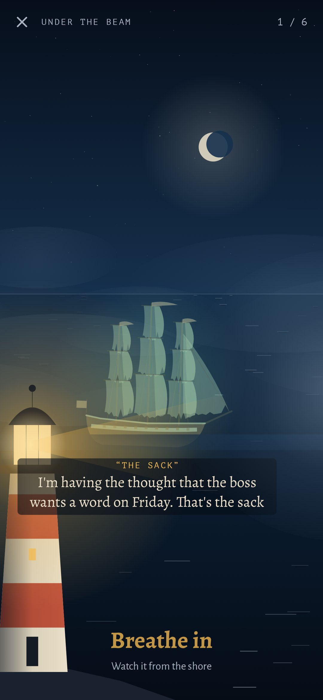 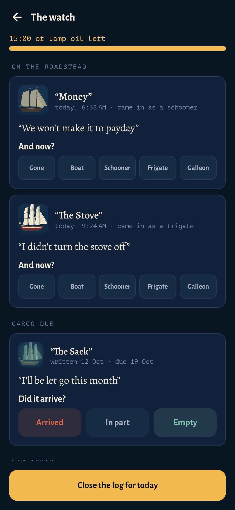 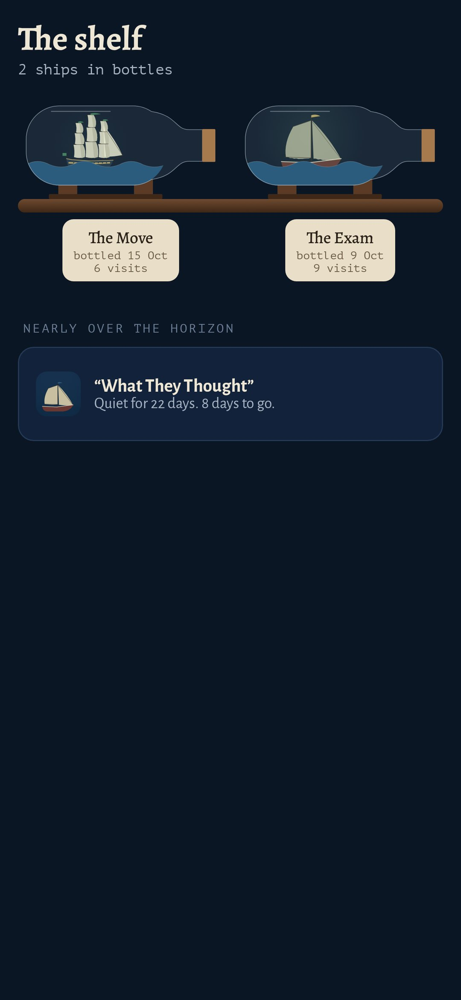

</div>

---

## The idea

Thoughts like "I'll be fired" don't go away when you argue with them, and they don't go away when someone tells you it'll be fine. Keeper takes four well-tested ideas from CBT and ACT and puts them on the water:

- **Defusion.** Name the thought and give it a ship. "The Sack is on the horizon again" feels different from "I'll be fired".
- **Worry postponement.** During the day a ship is lit and let pass, or anchored. It's looked over once a day, at the evening watch.
- **Checking forecasts.** On the watch, a ship's cargo is written down as a forecast with a due date. On that day the log asks whether it arrived.
- **Decatastrophising.** "And if it does, then what?", sounded down to the bottom, where the lifeboat is: what you would actually do.

**The lighthouse doesn't console.** It never says "it'll be fine", and it has no button to calm you down. Seeking reassurance only feeds this kind of thought. What it gives you instead is your own log.

## What's inside

| | Feature | How it works |
|---|---|---|
| 🚢 | **Ship on the horizon** | One line in your own words, the ship (picked, or a new one named), its tonnage (boat, schooner, frigate, galleon) and where it sailed in from. It takes a few seconds from the quick-settings tile. |
| 🔦 | **Under the beam** | The lamp keeps time for your breath: in as it turns toward you, out as it sweeps away (4·6, 4·4·4 or 4·7·8). The ship crosses the bay with its thought beneath it, *"I'm having the thought that…"*, and goes into the fog. Then you weigh it again. |
| ⚓ | **The roadstead** | A ship that keeps coming back stays at anchor until the watch. One that has come three times in the past hour isn't lit again: lighting it would be one more round of the same. |
| 🕯️ | **The evening watch** | Once a day, at a set time, with a lamp-oil timer. Weigh each anchored ship again (it's often smaller by evening), write its cargo, chart it, and check the cargo that's due. Then close the log until tomorrow. |
| 📦 | **The ship's log** | Every forecast and what came of it, as a row of crates: "Of 15 cargoes checked, 1 arrived". It also shows how much lighter ships were after the beam and by the watch. |
| 👻 | **Ghost ships** | A ship whose forecasts keep coming to nothing goes translucent and green, with torn sails. You can see that it carries nothing. |
| 🗺️ | **The chart** | "And then?", step by step down to the bottom, with the lifeboat plan there. The chart is drawn on the watch, and the lifeboat can be read at any time. |
| 🍾 | **The shelf** | A ship that hasn't come for 30 days goes over the horizon and into a bottle, with a paper tag. |
| 🌫️ | **The bay** | Fog for the day's load, riding lights for ships at anchor, and stars when it's calm. |
| 📈 | **Each ship's page** | When it comes (weekday × hour), the ports it sails from, its size week by week, its cargo record and its chart. |
| 🌙 | **The foghorn** | For 3 a.m.: a near-black screen with only the beam turning in time with the breath and a soft buzz. Swipe down to leave. |
| 🔔 | **One reminder** | At watch time, and only if a ship is at anchor or a cargo is due. |
| 💾 | **Backup** | Everything in one JSON file. |

Keeper doesn't replace therapy. If thoughts get in the way of work, sleep or people, a CBT therapist can help; with intrusive thoughts and checking, ask about exposure and response prevention (ERP).

## Privacy

There is no account, no cloud, no analytics and no internet permission. Everything stays on the phone.

## Screenshots

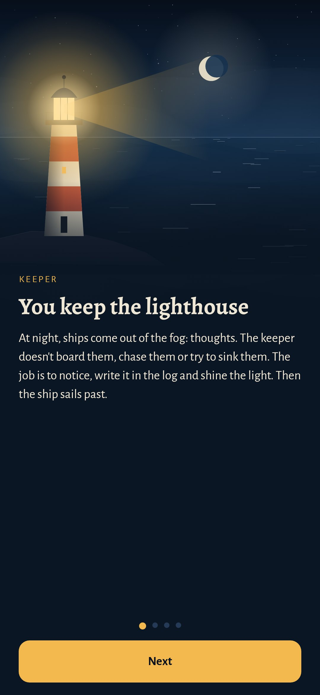 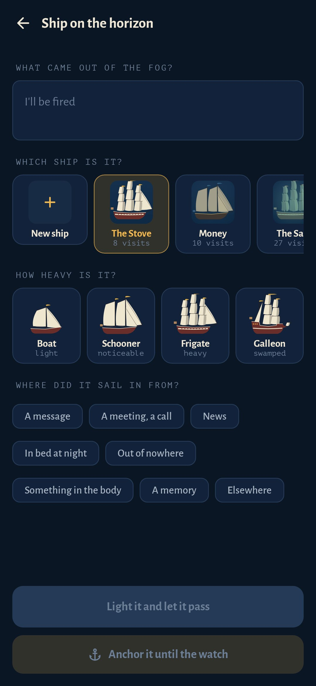 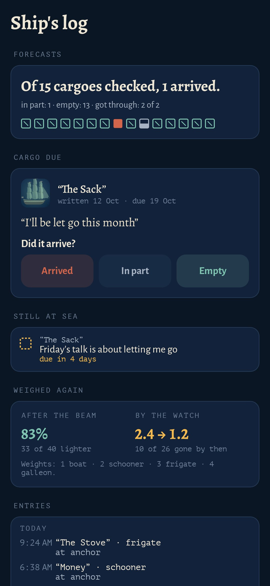 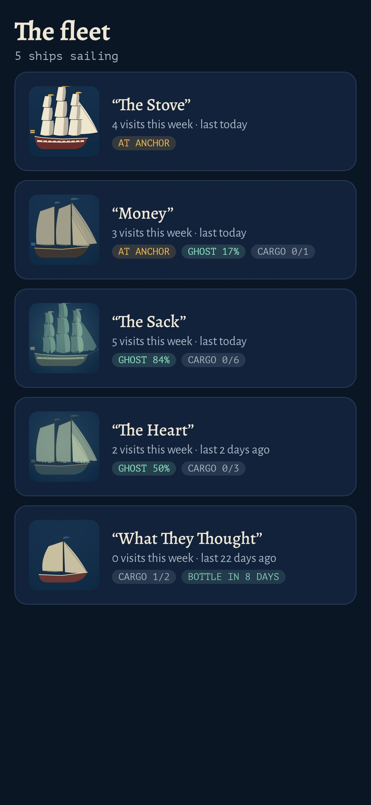 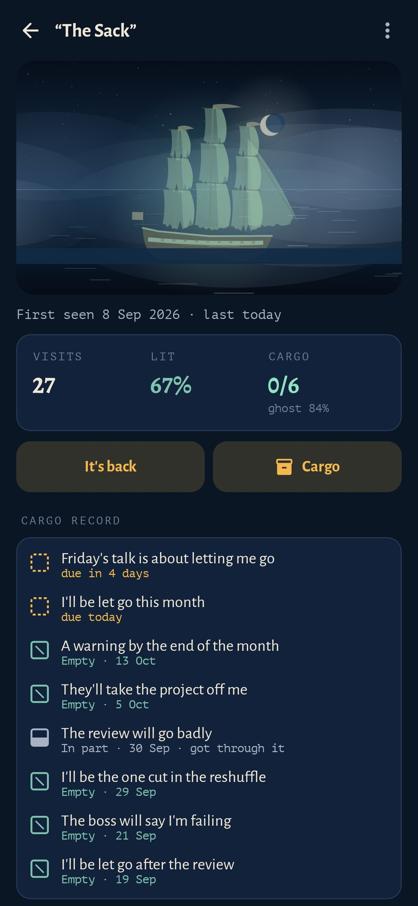 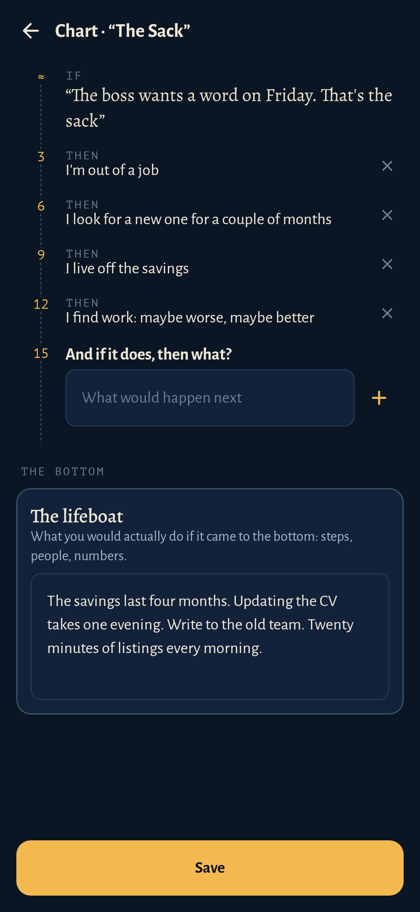

## Build

```bash
./gradlew assembleDebug             # app.keeper.dev
./gradlew assembleDebug -Pdemo      # app.keeper.demo, six made-up weeks of ships
./gradlew testDebugUnitTest         # unit tests
./gradlew testDebugUnitTest -Prender --tests '*RenderArt*'   # ships, bottles, the bay and every screen to app/build/art
python tools/shots.py               # those screen renders into docs/screenshots
```

Kotlin, Jetpack Compose, Room, DataStore. The ships are drawn procedurally on a Compose canvas from a seed, along with the lighthouse, the beam, the fog and the bottles. Fonts: Alegreya, Alegreya Sans and PT Mono (OFL).

Part of [Stillcraft](https://bigdevwhale.github.io/stillcraft/). MIT licence.
