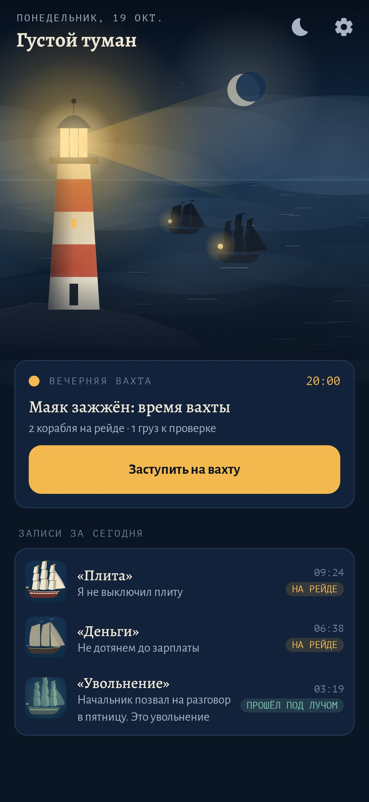
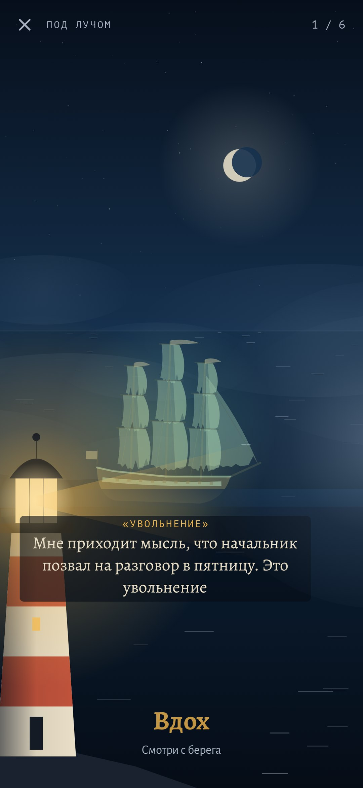
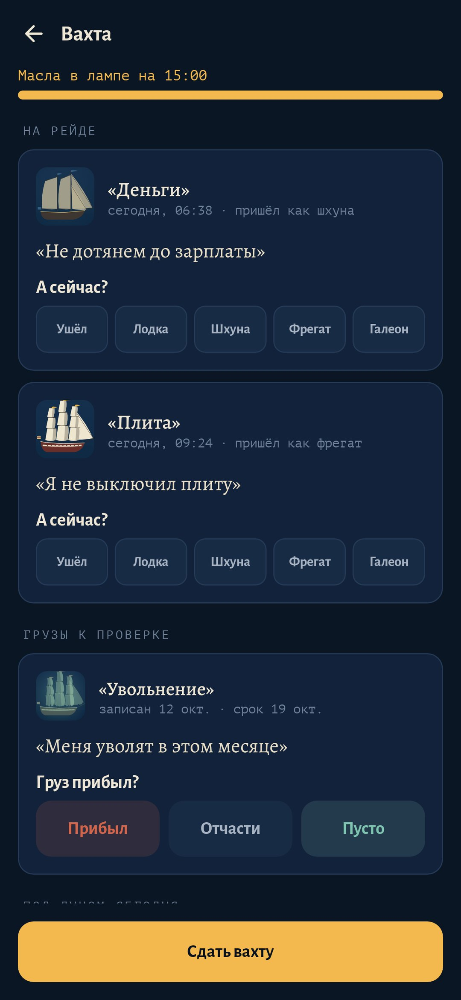
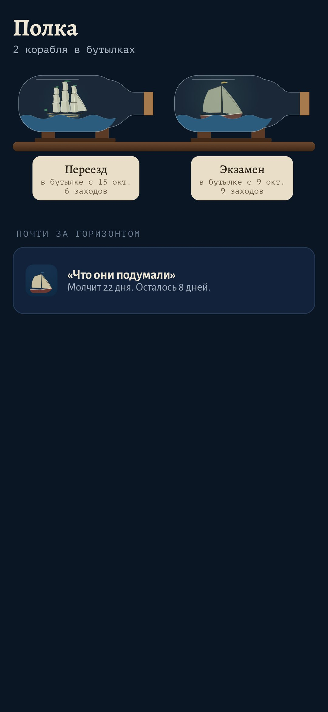
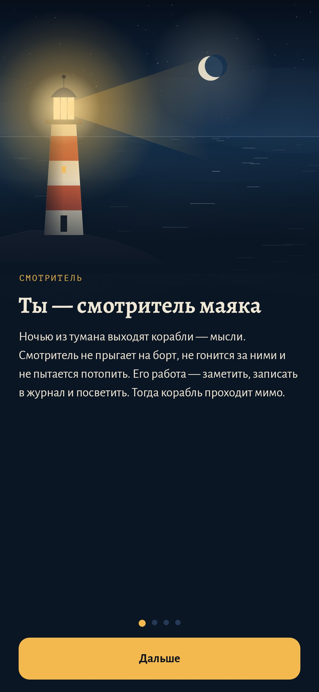
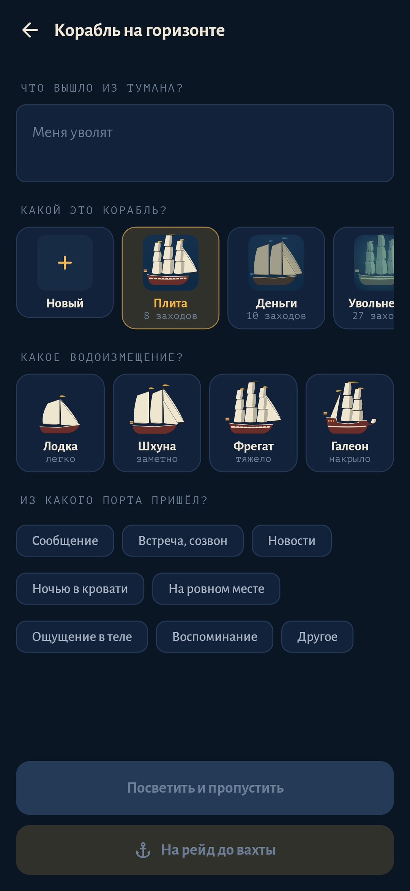
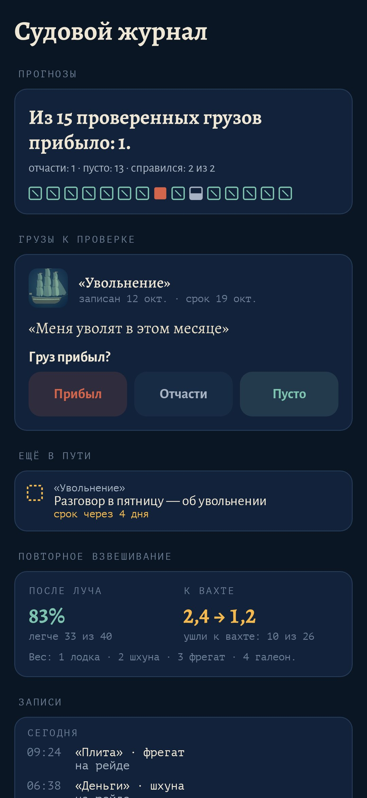
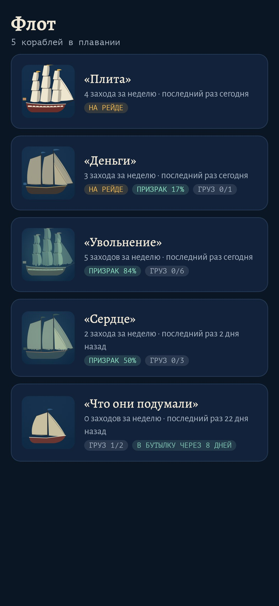
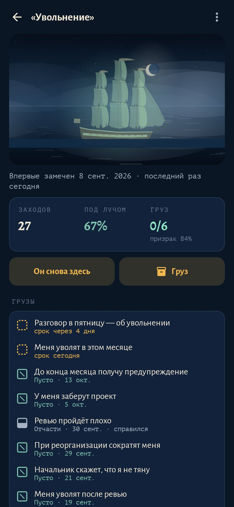
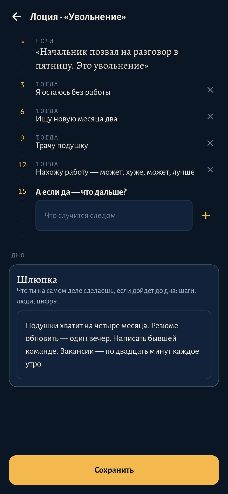

<div align="center">


# Смотритель (Keeper)

### Мысли — это корабли. Ты — смотритель маяка.

*Каждая навязчивая, повторяющаяся мысль становится кораблём с именем. Его записывают в журнал, освещают и смотрят, как он проходит мимо, или ставят на якорь до вечерней вахты. Прогнозы сверяются с тем, что случилось на самом деле. Корабли, чьи прогнозы не сбываются, превращаются в призраков, а те, что перестали заходить, оказываются в бутылках на полке. Бесплатно, без рекламы, без аккаунта и без доступа в интернет.*

[](https://github.com/bigdevwhale/keeper/actions/workflows/android.yml)
[](https://github.com/bigdevwhale/keeper/releases/latest)


[](LICENSE)

[English](README.md) · **Русский** · [Изменения](CHANGELOG.md)

   

</div>

---

## Идея

Мысли вроде «меня уволят» не уходят, если с ними спорить, и не уходят, когда тебе говорят «всё будет хорошо». Смотритель берёт четыре проверенные идеи из КПТ и ACT и переносит их на воду:

- **Когнитивное разделение.** Мысль получает имя и корабль. «Опять „Увольнение“ на горизонте» звучит иначе, чем «меня уволят».
- **Отложенное беспокойство.** Днём корабль пропускают под лучом или ставят на якорь. Осматривают его раз в день, на вечерней вахте.
- **Проверка прогнозов.** На вахте груз корабля записывают как прогноз со сроком. В этот день журнал спрашивает, прибыл ли он.
- **Декатастрофизация.** «А если да — что дальше?» промеряется до самого дна. На дне лежит шлюпка: что ты на самом деле сделаешь.

**Маяк не утешает.** Он не говорит «всё будет хорошо», и кнопки «успокой меня» в нём нет. Поиск утешения только кормит такие мысли. Вместо утешения у тебя есть собственный журнал.

## Что внутри

| | Функция | Как это работает |
|---|---|---|
| 🚢 | **Корабль на горизонте** | Одна строка своими словами, корабль (выбрать или назвать новый), водоизмещение (лодка, шхуна, фрегат, галеон) и порт, из которого он пришёл. Из шторки занимает несколько секунд. |
| 🔦 | **Под лучом** | Луч задаёт ритм дыхания: вдох, пока он поворачивается к тебе, выдох, пока уходит (4·6, 4·4·4 или 4·7·8). Корабль пересекает бухту, а под ним идёт мысль: *«Мне приходит мысль, что…»*. Потом он уходит в туман, и его взвешивают заново. |
| ⚓ | **Рейд** | Корабль, который возвращается, ждёт вахты на якоре. Если он пришёл в третий раз за час, его больше не освещают: это был бы ещё один круг того же самого. |
| 🕯️ | **Вечерняя вахта** | Раз в день, в назначенное время, с таймером-маслом в лампе. Каждый корабль на рейде взвешивают заново (к вечеру он часто меньше), записывают его груз, прокладывают лоцию и проверяют грузы, у которых настал срок. Потом журнал закрывается до завтра. |
| 📦 | **Судовой журнал** | Все прогнозы и то, чем они кончились, рядом ящиков: «Из 15 проверенных грузов прибыло: 1». Там же видно, насколько легче корабли стали после луча и к вахте. |
| 👻 | **Корабли-призраки** | Корабль, чьи прогнозы не сбываются, становится полупрозрачным и зелёным, с рваными парусами. Видно, что он возит пустоту. |
| 🗺️ | **Лоция** | «А потом?» шаг за шагом до дна, а на дне план-шлюпка. Курс прокладывают на вахте, а шлюпку можно открыть всегда. |
| 🍾 | **Полка** | Корабль, который не заходил 30 дней, уходит за горизонт, в бутылку с бумажной биркой. |
| 🌫️ | **Бухта** | Туман по нагрузке дня, огни кораблей на якоре и звёзды, когда спокойно. |
| 📈 | **Страница корабля** | Когда приходит (день недели × час), из каких портов, его размер по неделям, грузы и лоция. |
| 🌙 | **Туманный горн** | На три часа ночи: почти чёрный экран, на нём только луч в ритме дыхания и мягкая вибрация. Чтобы выйти, проведи вниз. |
| 🔔 | **Одно напоминание** | В час вахты, и только если на рейде есть корабль или пора проверить груз. |
| 💾 | **Резервная копия** | Всё в одном JSON-файле. |

Смотритель не заменяет терапию. Если мысли мешают работе, сну или людям, поможет специалист по КПТ. При навязчивых мыслях и проверках спроси про экспозицию с предотвращением реакции (ERP).

## Приватность

Нет ни аккаунта, ни облака, ни аналитики, ни доступа в интернет. Всё остаётся на телефоне.

## Скриншоты

     

## Сборка

```bash
./gradlew assembleDebug             # app.keeper.dev
./gradlew assembleDebug -Pdemo      # app.keeper.demo, шесть выдуманных недель
./gradlew testDebugUnitTest         # тесты
./gradlew testDebugUnitTest -Prender --tests '*RenderArt*'   # корабли, бутылки, бухта и все экраны в app/build/art
python tools/shots.py               # рендеры экранов в docs/screenshots
```

Kotlin, Jetpack Compose, Room, DataStore. Корабли рисуются процедурно на Compose-холсте из seed, как и маяк, луч, туман и бутылки. Шрифты: Alegreya, Alegreya Sans и PT Mono (OFL).

Часть [Stillcraft](https://bigdevwhale.github.io/stillcraft/). Лицензия MIT.
